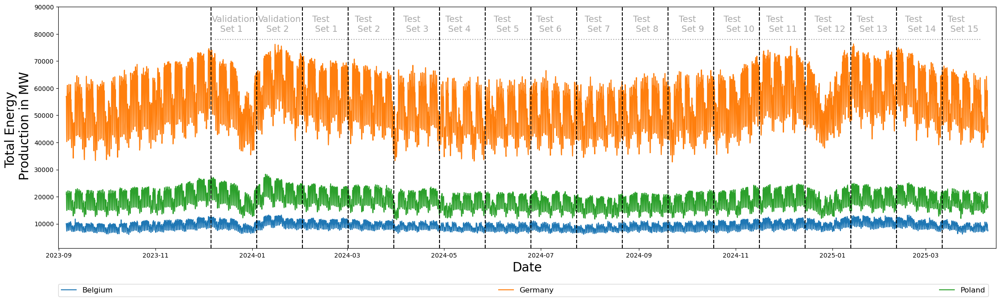
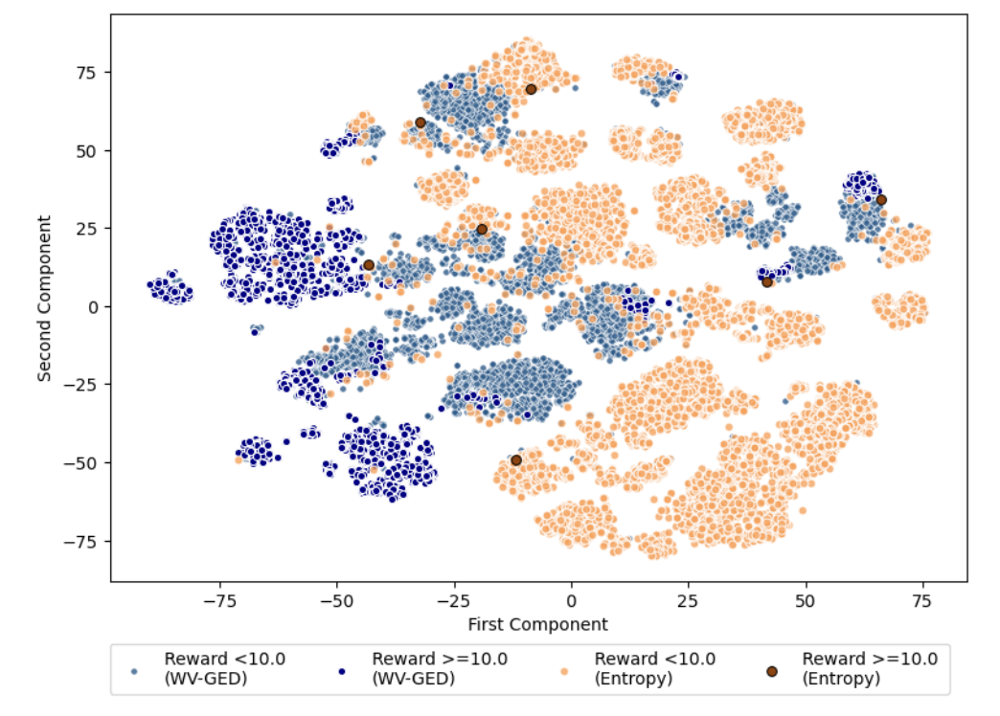
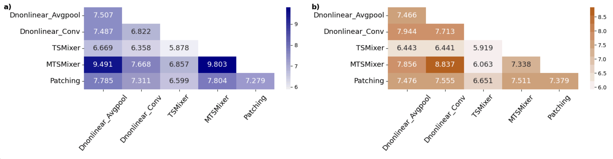
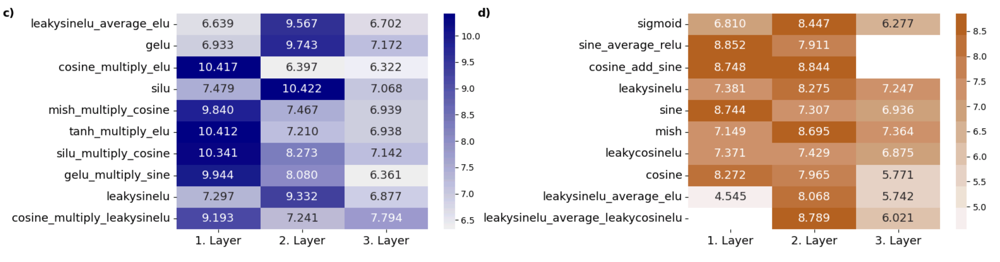
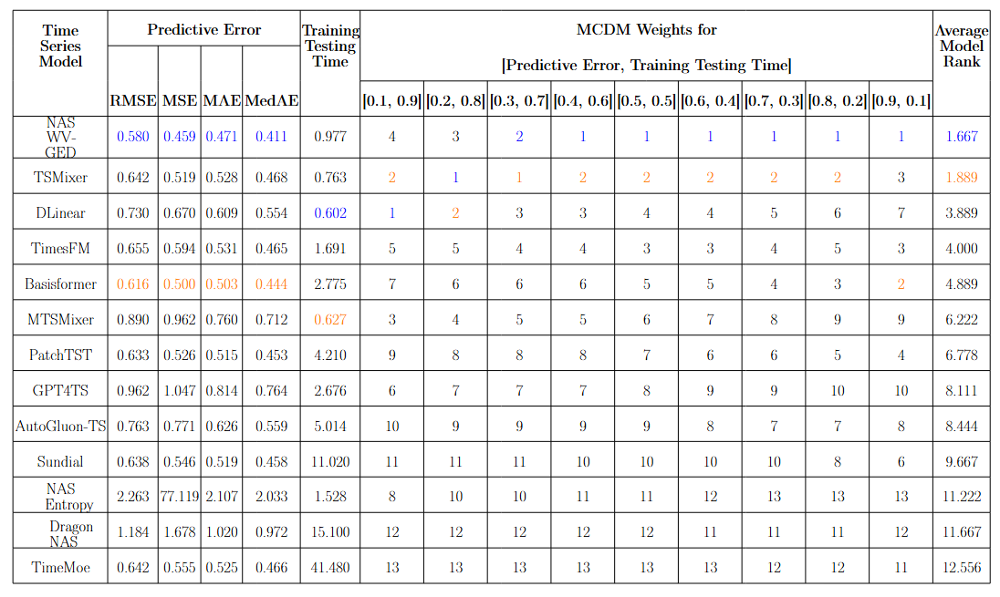

# NAS_Energy_Generation

This is the official github repository for the paper "Neural Architecture Search for Global Multi-Step Forecasting of Energy Production Time Series".

## **Contributions**
Our study, which lies at intersection of global, multi-step energy prediction and neural architecture search (NAS) for time series forecasting, delivers three contributions:  <br>
- we design of a novel macro NAS search space consisting of efficient network components selected to capture
the complex temporal patterns inherent in energy-related time series, e.g., local
semantic information of the input sequences, multiple trend and periodic components, etc. 
- we formulate of a novel reward signal optimized during NAS, which accounts for challenges related to both
performance generalization in the energy domain and the maximal exploration of
different regions of the search space. 
- in an empirical context, we demonstrate that our NAS approach outperforms state-of-the-art transformer architectures and pre-trained models in both computational efficiency and predictive accuracy on multiple energy production-related datasets across 15 out-of-time test subsets. <br>

The Figure below exemplies the patterns in total energy production time series in three EU countries:



## **Key Results**
- The Reinforcement Learning agent, i.e., Actor-Critic (AC) controller, trained with our novel reward signal (WV-GED) traverses more diverse search space regions in comparison to AC trained with an an entropy-based baseline, thereby effectively mitigating local optimum points encountered during NAS:<br>


- The best performing ensemble of NAS models consists of MTSMixer blocks only, and makes use of novel composite nonlinearities. The Figure below visualizes key elements-time series blocks and (composite) activations-of the explored search space under both reward signal formulations. Figures a) and c) are related to our NAS approach, whereas Figures b) and d) are associated with entropy-based NAS:<br>



- The final evaluation of our approach takes into account 4 predictive error criteria, as well as a metric quantifying runtime efficiency, i.e., the toal number of minutes necessary for each model to complete the training and inference phases. We intergrate the individual evaluation metrics using TOPSIS with different preference schemes. The figure below shos that our NAS approach achieves the best aggregated rank, reflecting its advantages concerning predictive accuracy and runtime efficiency in comparison to 12 baselines approaches:<br>



## **Reproducibility**
1. Install requirements. ```pip install -r requirements.txt```

2. To import the data and run all models, execute the cells in the notebook ```Run_Models.ipynb``` in the folder  ```./Src/```.


## **Acknowledgements**

We appreciate the following github repositories very much for the valuable code base:

MTSMixer: https://github.com/plumprc/MTS-Mixers

Basisformer: https://github.com/nzl5116190/Basisformer

DLinear: https://github.com/cure-lab/LTSF-Linear

PatchTST: https://github.com/yuqinie98/PatchTST

DRAGON-NAS: https://github.com/JulieKeisler/DRAGON

AutoGluon-NAS: https://github.com/autogluon/autogluon 


## **Contact**

If you have any questions or concerns, please contact us: velegeor@hu-berlin.de, stefan.lessmann@hu-berlin.de. 

## **Citation**

If you find this repo useful in your research, please consider citing our paper as follows:

```
@article{VelevLessmann_2025_NAS_EGF,
  title     = {Neural Architecture Search for Global Multi-Step Forecasting of Energy Production Time Series},
  author    = Velev, Georg and
              Lessmann, Stefan},
  journal = {arxiv preprint arXiv:2511.00035},
  year      = {2025}
}
```
