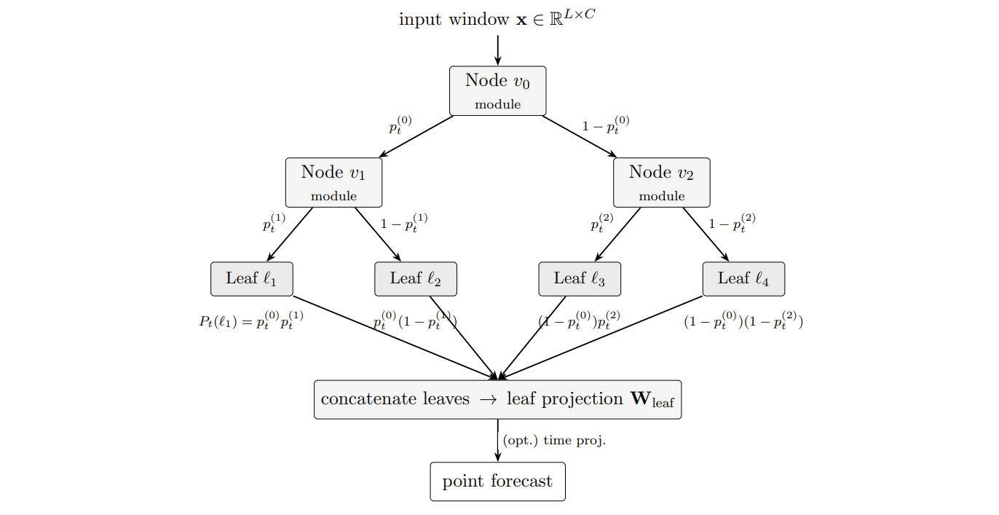

# Tree-Structured Neural Architecture Search (NAS) for probabilistic time series modelling

**Type:** Master's Thesis

**Author:** Shaig Khankishizade

**Supervisor:** M.Sc. Georg Velev

**1st Examiner:** Prof. Dr. Stefan Lessmann

**2nd Examiner:** Prof. Dr. Katarzyna Reluga

<!-- TODO: figure. Best candidate is the tree search space schematic from
Chapter 3, or the block-frequency-by-position chart from 5.1 that shows the
8%-to-82% shift. Save it as result.png in the repo root. -->


<p align="center">
  
</p>


## Table of Content

- [Summary](#summary)
- [Working with the repo](#Working-with-the-repo)
    - [Dependencies](#Dependencies)
    - [Setup](#Setup)
- [Reproducing results](#Reproducing-results)
    - [NAS Search](#NAS-search)
    - [Benchmarking](#Benchmarking)
    - [GP calibration](#GP-calibration)
- [Results](#Results)
- [Project structure](#Project-structure)
- [Contact](#Contact)

## Summary

Day-ahead electricity prices in Europe are formed in tightly coupled markets, and
multivariate models that exploit that coupling are now standard. Their
architectures are not chosen the same way: automated selection in this field
covers inputs and hyperparameters while network structure stays hand-designed,
and the architecture search that does exist composes blocks in a chain.

This thesis transfers an architecture search method from energy production series
to day-ahead prices and extends it from a chain-structured space to a larger one
with branching and learned per-time-step routing. The selected architectures are
turned into probabilistic forecasters by a sparse Gaussian process fitted to
forecast errors held out of training, with the shape of the predictive tails
estimated separately for each market. Both search spaces are run under identical
settings, ten runs each, at horizons of 48, 96 and 192 hours, and evaluated on
walk-forward blocks covering 2024 and 2025 across 19 coupled European markets,
against each other and against ten published baselines.

Topology changes what the search selects: given the same blocks and the same
objective, the tree arm's controller comes to place a decomposition block at the
root in 82 per cent of samples against an initial 8, while the chain arm barely
moves. Accuracy does not follow. The difference between the two arms is
horizon-dependent and mostly not significant, with the chain arm leading at 96
hours and Diebold–Mariano tests separating the two only at 192. The
distributional head produces intervals that are calibrated over the evaluation
period as a whole but neither calibrated within individual blocks nor informative
about which particular forecasts will be poor. A tail index shared across markets
matches the per-market estimate on pooled coverage while performing worse on
proper scores and on agreement between markets, so pooled calibration alone can
conceal how a model serves individual series.

**Keywords**: neural architecture search; electricity price forecasting;
probabilistic forecasting; Gaussian processes; multivariate time series;
calibration; day-ahead markets


## Working with the repo

### Dependencies

Python 3.11. A GPU is required to reproduce the
search within a reasonable time; the Gaussian-process head and the evaluation
scripts run on CPU.

All dependencies are pinned in `requirements.txt`.

### Setup

1. Clone this repository

2. Create a virtual environment and activate it
```bash
python3 -m venv .venv
source .venv/bin/activate
```

3. Install torch separately
```bash
pip install torch==2.6.0 --index-url https://download.pytorch.org/whl/cu124
```

4. Install requirements
```bash
pip install -r requirements.txt
```

5. Read requirements.txt to install relevant packages for benchmarking


4. Data must be processed  with [Run_Baseline_Models](Src/Run_Baseline_Models.ipynb)from .csv files into torch DataLoader.

## Reproducing results

The pipeline has five stages and each should map to one entry point:
1. data preparation  
2. architecture search (both arms, per horizon)
3. candidate selection (top ten architectures per arm)
4. walk-forward benchmarking (point forecasts + residual bank)
5. calibration and evaluation (GP head --> calibration)
6. Evaluate Results (Collect Results, DM tests, TOPSIS)


### NAS search

- Run scripts [run_NAS_GED.py](Src/run_NAS_GED.py) for tree arm and [run_NAS_GED_chain.py](Src/run_NAS_GED_chain.py) for chain arm NAS search.
- NAS Search figures are reproduced with [NAS plots](Visualization/NAS_plots.py)

### Benchmarking

- Baselines Benchmarks are carried out in [Run_Baseline_Models Notebook](Src/Run_Baseline_Models.ipynb)
- For NAS Tree ensemble and NAS chain ensemble benchmarks follow instructions at [Results_Analys Notebook](Src/Results_Analysis.ipynb)

### GP calibration

After ensemble benchmarks are in Results_Evaluation Folder, carry out the following:
- [Run GP_runner.py](Benchmark_Models/GP_runner.py)
- [Compute uncertainty metrics](Src/GP_results_scripts/GP_uncertainty_diagnostics.py) and [aggregate metrics](Src/GP_results_scripts/GP_results_aggregate.py)
- [GP Plots](Visualization/GP_figures.py) used for producing GP related figures
- With GP results in Results_Evaluation Folder, one can use [plot intervals](Visualization/Forecast_plots/plot_intervals.py) to plot predictive intervals of forecasts.

### Directories
Every script mentioned above has docstrings with instructions. Please check the Parent Directory variables for a functional code.


## Results

For Results, TOPSIS, and DM tests:
- See [Results_Analysis.ipynb](Src/Results_Analysis.ipynb)


## Project structure


```bash
├── README.md
├── requirements.txt                    -- required libraries
├── Energy_Data                         -- ENTSO-E day-ahead prices, 19 markets
├── Neural_Architecture_Search          -- the search framework: defines the
│                                          Framework class used by run_NAS
├── run_NAS
│   ├── run_NAS_GED.py                  -- runs the tree-structured search
│   └── run_NAS_GED_chain.py            -- runs the chain-structured search
├── Benchmark_Models                    -- baseline models and benchmarking classes
│   ├── GP_Last_Layer_LMC.py            -- Gaussian-process head
│   ├── gp_calibration.py               -- calibration helpers
│   └── GP_Runner.py                    -- runs the GP experiments
├── Results_Evaluation                  -- run outputs: searches, NAS runs and
│                                          benchmark results
├── Src
│   ├── Run_Baseline_Models.ipynb       -- data processing and baseline runs
│   ├── Results_Analysis.ipynb          -- computes metrics and analyses results
│   └── stored_metric_results           -- experiment outputs as .pkl
└── Visualization                       -- plotting scripts and figure folders
```

## Contact

Questions about the code or the thesis: 
- Academic email: [shaig.khankishizade@student.hu-berlin.de](mailto:shaig.khankishizade@student.hu-berlin.de)
- Personal email: [shaik.khankishizade@gmail.com](mailto:shaik.khankishizade@gmail.com)
